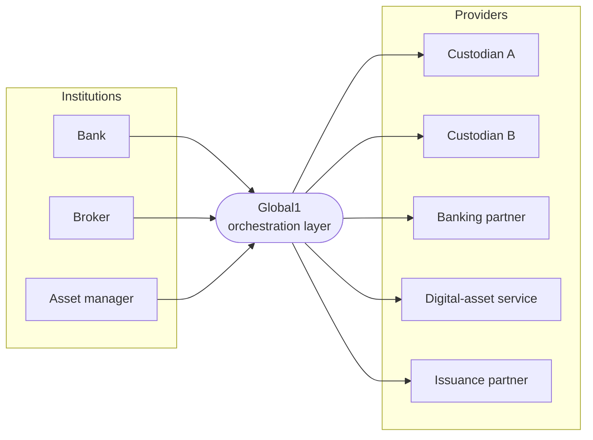

  <a href="https://globalized.io">
    <picture>
      <source media="(prefers-color-scheme: dark)" srcset="assets/logotype-dark.svg">
      
    </picture>
  </a>

<h3 align="center">Connecting the future.</h3>

  <a href="https://globalized.io">Website</a> ·
  <a href="https://globalized.io/ecosystem">Ecosystem</a> ·
  <a href="https://globalized.io/careers">Careers</a> ·
  <a href="https://globalized.io/contact">Contact</a> ·
  <a href="https://www.linkedin.com/company/globalizd/">LinkedIn</a> ·
  <a href="https://x.com/globalized_io">X</a>

---

Globalized operates Global1, an orchestration layer for institutional digital-asset operations. It enables banks, asset managers, hedge funds, exchanges and other financial institutions to define their own controls, routing and operating model while using regulated providers as one system, so that adopting digital assets becomes comparable to the way institutions already consume financial infrastructure, without the layer ever holding keys, funds or accounts of record.

### How it works

- Like a direct integration, Global1 executes every regulated action at a licensed provider, under an account held in the institution's own name.
- Institutions see one record of their operations whichever provider carried them out, with one status vocabulary across all of them.
- Every operation that moves value is journaled before any provider is contacted and settled only from what the provider is observed to have done.
- Each institution routes independently, per asset, network, currency and provider, and adds or replaces a provider without changing its integration.
- Every state change is recorded in a hash-chained audit log per organisation.

Tier-one custodians, conversion providers, banking partners, staking providers and tokenization providers connect through the same interfaces, and the institution's integration is the same whichever of them execute.

Institutions and providers each connect to the layer once. Operations and records flow through the layer; accounts and agreements run directly between an institution and each of its providers. No institution integrates a provider, and the layer holds neither keys nor funds.

### How we build

Our core systems are written in Rust. Memory safety is not something you can add to a settlement system after the fact, so we chose a language that enforces it. Globalized is a founding member of the [Rust Commercial Network](https://globalized.io/news/rust-commercial-network), alongside AWS, Google, Microsoft, GitHub and OpenAI.

### Security

Found a vulnerability? Please read our [security policy](https://github.com/globalized-io/.github/blob/main/SECURITY.md) and report it privately. Do not open a public issue.
