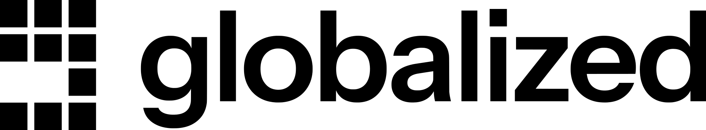

  <a href="https://globalized.io">
    <picture>
      <source media="(prefers-color-scheme: dark)" srcset="assets/logotype-dark.svg">
      
    </picture>
  </a>

<h3 align="center">Connecting the future.</h3>

  <a href="https://globalized.io">Website</a> ·
  <a href="https://globalized.io/ecosystem">Ecosystem</a> ·
  <a href="https://globalized.io/careers">Careers</a> ·
  <a href="https://globalized.io/contact">Contact</a> ·
  <a href="https://www.linkedin.com/company/globalizd/">LinkedIn</a> ·
  <a href="https://x.com/globalized_io">X</a>

---

Globalized is a fintech platform bridging traditional finance and digital assets. We give financial operators one integration for banking, payments and custody across 180+ countries and 14 blockchains, with every service sourced from regulated and licensed providers and compliance built into every layer.

### What we build

- **Platform as a Service** – modular, prebuilt infrastructure for launching financial services on licensed rails.
- **Embedded Finance** – enterprise-grade financial capabilities inside existing systems.
- **Custody** – multi-chain MPC custody for institutions.

### How we build

Our core systems are written in **Rust**. Memory safety is not something you can add to a settlement system after the fact, so we chose a language that enforces it. Globalized is a founding member of the [Rust Commercial Network](https://globalized.io/news/rust-commercial-network), alongside AWS, Google, Microsoft, GitHub and OpenAI.

### Security

Found a vulnerability? Please read our [security policy](https://github.com/globalized-io/.github/blob/main/SECURITY.md) and report it privately. Do not open a public issue.
